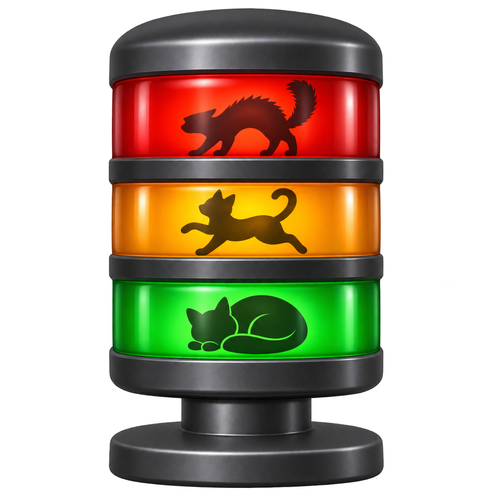

# andon



複数の VS Code ウィンドウで Claude Code を動かしているときに、**入力を待っているセッションを一覧し、クリック 1 回でそのウィンドウへ移る**ための、Windows 向けの小さなウィンドウです。

全部のウィンドウを巡回して終わったものを目で探す代わりに、許可待ち・質問待ち・完了したセッションが色付きで上に並びます。名前は、工場で各工程の状態を並べて表示し、助けが必要な工程が点灯する表示盤「アンドン」から取りました。

## 表示

ウィンドウとインストール時のショートカットには積層灯のアイコンを使います。通知領域では、状態を色で示します。

| 状態 | 色 | 意味 |
|---|---|---|
| 許可待ち / 質問待ち | 赤 | Claude があなたの承認や回答を待っている |
| 完了 | 黄 | 実行中から待機に変わり、まだ確認していない |
| 実行中 | 通常 | ツールの実行や応答の生成中 |
| 待機 | 灰 | 次のプロンプトを待っている（確認済み） |

- 行をクリックすると、そのセッションの VS Code ウィンドウが前面に出ます。
- 黄は、行をクリックする、右クリックの「既読にする」、「すべて既読」、そのセッションで次のプロンプトを送る、のいずれかで消えます。
- VS Code の Claude Code 拡張機能（パネル）のセッションは、待機中は表示しません。拡張機能は、パネルを閉じても `claude` を終了させずに待機中のまま残すためです。実行中・待ち・完了のときは表示します。完了は、ターミナルのセッションと同じく、確認するまで残ります。
- andon はタスクバーには出ず、通知領域（タスクトレイ）にアイコンを置きます。アイコンは、赤があれば赤、黄があれば黄、どちらもなければ灰になります。赤と黄の件数は、ウィンドウのタイトルとアイコンのツールチップに出ます。
- 新しく待ちや完了が出たとき、andon が前面になければ Windows の通知を出し、ウィンドウのタイトルバーを点滅させます。通知をクリックすると、そのセッションの VS Code ウィンドウが前面に出ます。通知の送り元は `andon` と表示されます（下の「インストール」で入れたショートカットや、「clone して動かす」の方法で起動したとき。対話で使っている PowerShell で直接 `.\andon.ps1` を動かしたときは、andon を終えたあともそのシェルに andon の名前が残らないよう、送り元は PowerShell のままにします）。通知を止めたり、バナーを出さないようにしたりするときは、Windows の「設定 → システム → 通知」で `andon` を選びます。
- 点滅は、andon を前面に出したときのほか、そのセッションの VS Code ウィンドウを前面に出したとき（通知のクリックでも、直接でも）や、そのセッションが待ちでも完了でもなくなったとき（VS Code で答えた、次のプロンプトを送った、既読にした）に止まります。完了の黄色は、確認するまで残ります。VS Code ウィンドウは、題名に入るフォルダ名や workspace 名で見分けるので、VS Code の設定 `window.title` を変えていると見分けられません。そのセッションの VS Code ウィンドウがすでに前面にあるときは、点滅しません。
- ウィンドウの × や最小化では、終了せずにトレイに隠れます。トレイのアイコンをクリックすると、表示と非表示が切り替わります。終了は、トレイのアイコンの右クリックのメニューから行います。
- Windows 11 では、新しいアイコンは最初、通知領域の `^` の中に隠れています。常に見えるようにするには、`^` の中からアイコンをタスクバーへドラッグします。

## 動作環境

- Windows 10 / 11
- Windows PowerShell 5.1 または PowerShell 7
- Claude Code（`claude agents --json` が対話セッションの `status` を返す版。動作確認は 2.1.318）
- VS Code の `code` コマンド（andon は、これを手がかりに `Code.exe` を探します）

Claude Code は VS Code の統合ターミナルなどで普通に `claude` を起動していれば対象になります。VS Code 拡張機能のパネルで会話したときも、実行中・待ち（許可・質問）・完了と表示されることを確認しています。

## インストール

[Releases](https://github.com/tbshiki/andon/releases) の最新の版から `andon-<版>.zip` を落として展開し、PowerShell で、展開したフォルダの `install.ps1` を実行します。管理者の権限は要りません。

```powershell
powershell.exe -NoProfile -ExecutionPolicy Bypass -File "<展開したフォルダ>\install.ps1"
```

`install.ps1` は次のことをします。ネットワークからは何も落としません。

- andon を `%LOCALAPPDATA%\Programs\andon` に置き、ダウンロードした印（Mark of the Web）を外す
- スタートメニューと、スタートアップ（ログオン時に起動）に `andon` のショートカットを作る。スタートアップに作らないときは、`-NoStartup` を付けて実行する
- andon を起動する

エクスプローラーの右クリックの「PowerShell で実行」は使わないでください。実行ポリシーを指定せずに PowerShell を起動するので、ダウンロードした印の付いた `install.ps1` は止められることがあります。上のコマンドの `-ExecutionPolicy Bypass` は、その PowerShell のプロセスにだけ効き、PC の実行ポリシーは変えません。andon のショートカットも、同じく andon のプロセスにだけ `Bypass` を付けて起動します。

落とした zip が Release のものと同じかは、[GitHub CLI](https://cli.github.com/) で確かめられます。Release は、公開したあとに中身を変えられない設定（immutable releases）にしています。

```powershell
gh release verify-asset v<版> .\andon-<版>.zip -R tbshiki/andon
```

起動すると、画面の右下に、常に手前に表示されるウィンドウが開き、通知領域にアイコンが出ます。二重に起動しても 2 つ目はすぐ終了します（トレイに隠れているときは、トレイのアイコンから表示します）。トレイから「終了」したあとは、スタートメニューの「andon」で起動します。トレイのメニューの先頭に、入っている版が出ます。

`-FallbackSec` で、変化がなくても状態を取り直す間隔（既定 30 秒）を変えられます。`-ScanMs` で、変化を見る間隔（既定 1000 ミリ秒、200〜5000）を変えられます。長くすると、待ちに気付くのが遅れます。使うときは、ショートカットのプロパティで、リンク先の末尾に `-ScanMs 500` のように付けます。更新しても引き継ぎます。

### 更新

新しい版の zip を落として、同じ手順で `install.ps1` を実行します。動いている andon を終わらせてからファイルを置き換え、起動し直します。スタートアップのショートカットを消していれば、作り直しません。

### アンインストール

```powershell
powershell.exe -NoProfile -ExecutionPolicy Bypass -File "$env:LOCALAPPDATA\Programs\andon\install.ps1" -Uninstall
```

動いている andon を終わらせて、次のものを消します。

- スタートメニューとスタートアップの `andon` のショートカット
- `%LOCALAPPDATA%\Programs\andon`
- `HKCU\Software\Classes\AppUserModelId\tbshiki.andon`（andon が、通知の送り元を `andon` と表示させるため、起動のたびに表示名を書くキー）
- `HKCU\Software\Microsoft\Windows\CurrentVersion\Notifications\Settings\tbshiki.andon`（最初の通知で Windows が作る、通知の設定）

Windows がトレイのアイコンについて覚えている設定（`HKCU\Control Panel\NotifyIconSettings` の `powershell.exe` の項目）は消しません。Windows が管理している場所で、ほかの PowerShell のスクリプトのアイコンと見分けにくいためです。

### 動かないとき

- グループ ポリシーで実行ポリシーが `AllSigned` か `Restricted` に決められている PC では、署名のない andon は動きません。`install.ps1` は、これを見つけると何もせずに終わります。
- App Control などで、PowerShell が制限された言語モード（Constrained Language Mode）で動く PC では、andon は動きません。`install.ps1` は、これを見つけると何もせずに終わります。

## clone して動かす（開発）

```powershell
git clone https://github.com/tbshiki/andon.git
Start-Process conhost.exe '--headless powershell.exe -NoProfile -STA -ExecutionPolicy Bypass -File .\andon\andon.ps1'
```

`conhost.exe --headless` は、PowerShell のコンソールをウィンドウなしで動かします。Windows 11 では既定のターミナルが Windows Terminal なので、`powershell.exe -WindowStyle Hidden` で起動すると、コンソールが Windows Terminal に引き渡されて隠れず、andon とは別にタスクバーに残ります。

clone から直接動かすときに、ログオン時に自動で起動するには、`Win + R` で `shell:startup` を開き、次のショートカットを置きます。インストールした andon と両方を置くと、どちらが起動するか決まらないので、どちらか一方にします。

- リンク先: `conhost.exe --headless powershell.exe -NoProfile -STA -ExecutionPolicy Bypass -File "<clone した場所>\andon.ps1"`

clone で `install.ps1` を実行すると、clone の `andon.ps1` を `%LOCALAPPDATA%\Programs\andon` に入れます。clone で `install.ps1 -Uninstall` を実行すると、レジストリのキーと、インストールした andon（あれば）を消します。手で置いたショートカットは、名前が `andon` で `andon.ps1` を起動するものなら消します。clone そのものは消しません。

## 仕組み

- **状態:** 公式の `claude agents --json` から読みます。対話セッションごとに `status`（`busy` / `waiting` / `idle`）と、`waiting` の理由（`waitingFor`）が返ります。
- **変化の検知:** `claude agents --json` は 1 回で CPU を 0.3 秒ほど使うので、短い間隔で呼び続けません。Claude Code は状態が変わるたびに `~/.claude/sessions/<pid>.json` を書き換えるので、1 秒ごと（`-ScanMs`）にそのファイル名と更新時刻だけを見て、変化があったときに呼びます。ファイルの中身は読みません。同じ場所にある `*.key` には触れません。`CLAUDE_CONFIG_DIR` を設定していればその下を見ます。
- **拡張機能のパネルの区別:** `claude agents --json` は、ターミナルのセッションも拡張機能のパネルのセッションも `kind: interactive` として返します。新しいセッションが出たときに一度だけ、そのプロセスの起動引数に `--input-format stream-json` があるかを見て区別します。
- **ウィンドウの特定:** セッションの作業フォルダから、次の順に開く対象を決めて VS Code に渡します。VS Code は、その workspace やフォルダを開いているウィンドウがあれば、新しく開かずにそのウィンドウを前面に出します。`code` コマンド（`code.cmd`）は cmd.exe を通り、パスの `%VAR%` が展開されてしまうので、隣にある `Code.exe` に直接渡します（`Code.exe` が見つからなければ `code.cmd` を使います）。
  1. 作業フォルダから repository の root まで遡り、`*.code-workspace` があれば最も近いもの
  2. repository の親フォルダと、その隣のフォルダにある `*.code-workspace` のうち、`folders` に repository（または作業フォルダを含む、その中のフォルダ）を挙げているもの（multi-root workspace）。複数あれば、作業フォルダに最も近いフォルダを挙げているもの
  3. どちらもなければ repository の root（git の外なら作業フォルダ）
- 無関係な workspace を開かないよう、repository の root より上の階層の `*.code-workspace` は、`folders` で repository を挙げていない限り使いません。`folders` に親フォルダ全体（`..` など）を挙げているだけの workspace も使いません。
- Claude Code が作る worktree（`<repo>\.claude\worktrees\<name>`）は、元の repository として扱います。
- **更新と削除の前の終了:** `install.ps1` は、名前付きのイベント `Local\andon-exit` で andon に終わるよう合図し、二重起動を防ぐ mutex `Local\andon` が消えるのを待ってから、ファイルを置き換えます。待たずに起動し直すと、新しい andon が二重起動と判断して終わってしまうためです。合図を受けられない古い版は、`andon.ps1` を `-File` で動かしている PowerShell のプロセスを止めます（トレイのアイコンは、マウスを重ねるまで残ります）。

## 制約

- 前面に出せるのはウィンドウまでです。どのターミナルのタブかまでは選べません。
- workspace がないとき、repository のサブフォルダを直接開いているウィンドウや、repository より広いフォルダ（親フォルダ全体など）を開いているウィンドウは特定できません。repository の root が新しいウィンドウで開きます。
- andon を起動した時点で待機中のセッションは、いつ終わったか分からないので「待機」（確認済み）として表示します。
- 変化を見る間隔（`-ScanMs`）に `claude agents --json` の実行時間を足したくらいより短いやり取りは、「完了」を取りこぼすことがあります。
- `~/.claude/sessions` は Claude Code の内部のディレクトリなので、書き方が変わるかもしれません。その場合も `-FallbackSec` ごとの取得で状態には追従します。
- background セッション（`claude --bg` など）も一覧に出ますが、クリックで開けるのは作業フォルダの VS Code ウィンドウです。会話そのものは `claude agents` で開いてください。
- 動作確認は Windows の VS Code でのみ行っています。

## 開発

GUI に依存しない部分のテストを、Windows PowerShell 5.1 と PowerShell 7 の両方で実行します。`install.ps1` は、実際の場所（`%LOCALAPPDATA%`、スタートメニュー、スタートアップ、`HKCU`）に書き込み、動いている andon を終わらせるので、テストでは、場所を引数で変えられる部分だけを確かめます。

```powershell
powershell.exe -NoProfile -ExecutionPolicy Bypass -File .\tests\Test-Andon.ps1
pwsh -NoProfile -File .\tests\Test-Andon.ps1
```

`*.ps1` は UTF-8 BOM 付き・CRLF で保存します。BOM がないと、Windows PowerShell 5.1 が日本語を読み違えます。AI で開発するときの規約は [`AGENTS.md`](AGENTS.md) にあります。

## セキュリティ

脆弱性は公開の Issue に書かず、[SECURITY.md](SECURITY.md) の手順で非公開で報告してください。

## License

[MIT](LICENSE)
