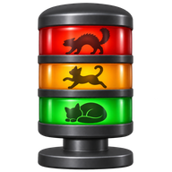

# andon



Claude Code を複数動かしているときに、**入力を待っているセッションを一覧し、クリック 1 回でそのウィンドウへ移る**ための、Windows 向けの小さなウィンドウです。VS Code の統合ターミナルや拡張機能のパネルのほか、Windows Terminal や cmd、PowerShell のウィンドウで起動したセッションも一覧に出ます。設定すれば、Codex（OpenAI の Codex CLI）のセッションも一覧に出ます（下の「[Codex のセッション](#codex-のセッション)」）。

全部のウィンドウを巡回して終わったものを目で探す代わりに、許可待ち・質問待ち・完了したセッションが色付きで上に並びます。名前は、工場で各工程の状態を並べて表示し、助けが必要な工程が点灯する表示盤「アンドン」から取りました。

## 表示

ウィンドウとインストール時のショートカットには積層灯のアイコンを使います。通知領域では、状態を色で示します。

| 状態 | 色 | 意味 |
|---|---|---|
| 許可待ち / 質問待ち | 赤 | Claude（または Codex）があなたの承認や回答を待っている |
| 完了 | 黄 | 実行中から待機に変わり、まだ確認していない |
| 実行中 | 緑 | ツールの実行や応答の生成中 |
| 待機 | 灰 | 次のプロンプトを待っている（確認済み） |

- 行をクリックすると、そのセッションのウィンドウが前面に出ます。VS Code の中（統合ターミナル、拡張機能のパネル）のセッションは、そのフォルダを開いている VS Code のウィンドウです。VS Code の外（Windows Terminal、cmd や PowerShell のウィンドウ）のセッションは、そのターミナルのウィンドウで、最小化していれば元に戻します。Windows Terminal は、ウィンドウを前面に出すだけで、タブまでは選びません。右クリックの「開く」も同じです。
- 黄は、行をクリックする、右クリックの「既読にする」、「すべて既読」、そのセッションで次のプロンプトを送る、のいずれかで消えます。
- VS Code の Claude Code 拡張機能（パネル）のセッションは、待機中は表示しません。拡張機能は、パネルを閉じても `claude` を終了させずに待機中のまま残すためです。実行中・待ち・完了のときは表示します。完了は、ターミナルのセッションと同じく、確認するまで残ります。
- andon はタスクバーには出ず、通知領域（タスクトレイ）にアイコンを置きます。アイコンの色は、一覧に出ているセッションから決めます。赤があれば赤、黄があれば黄、全部が実行中なら緑、それ以外（実行中と待機が混ざっている、セッションがない、など）は灰になります。赤と黄の件数は、ウィンドウのタイトルとアイコンのツールチップに出ます。
- 新しく待ちや完了が出たとき、andon が前面になければ Windows の通知を出し、ウィンドウのタイトルバーを点滅させます。通知をクリックすると、行のクリックと同じく、そのセッションのウィンドウが前面に出ます。通知の送り元は `andon` と表示されます（下の「インストール」で作られるショートカットや、「clone して動かす」の方法で起動したとき。対話で使っている PowerShell で直接 `.\andon.ps1` を動かしたときは、andon を終えたあともそのシェルに andon の名前が残らないよう、送り元は PowerShell のままにします）。通知を止めたり、バナーを出さないようにしたりするときは、Windows の「設定 → システム → 通知」で `andon` を選びます。
- 点滅は、andon を前面に出したときのほか、そのセッションのウィンドウを前面に出したとき（通知のクリックでも、直接でも）や、そのセッションが待ちでも完了でもなくなったとき（答えた、次のプロンプトを送った、既読にした）に止まります。完了の黄色は、確認するまで残ります。VS Code ウィンドウは、題名に入るフォルダ名や workspace 名で見分けるので、VS Code の設定 `window.title` を変えていると見分けられません。VS Code の外のターミナルは、ウィンドウそのもので見分けます。Windows Terminal では、そのウィンドウで別のタブを見ていても止まります。そのセッションのウィンドウがすでに前面にあるときは、点滅しません。
- ウィンドウの × や最小化では、終了せずにトレイに隠れます。トレイのアイコンをクリックすると、表示と非表示が切り替わります。終了は、トレイのアイコンの右クリックのメニューから行います。
- ウィンドウの位置と大きさ、「常に手前」は、次に起動したときに戻ります。モニターを外したなどで画面の外になっていれば、一番近い画面の中に動かします。覚えた値は `HKCU\Software\tbshiki\andon` に置きます。
- トレイのアイコンを右クリックして「テーマ」から、ライト・ダーク・Windows に合わせる（既定）を選べます。Windows に合わせるときは、Windows の「設定 → 個人用設定 → 色」の「既定のアプリ モード」に従い、変えるとすぐに切り替わります。ダークでも、待ちは赤、完了は黄、実行中は緑の、暗い色の行で示します。トレイのアイコンの色は、テーマによらず同じです。
- トレイのアイコンを右クリックして「縦表示」を選ぶと、1 件を 3 段（上の段に状態と経過、中の段にセッション名、下の段にフォルダ）で出す一覧に変わります。縦に細長いウィンドウを画面の端に置くときに使います。セッション名がないときは、中の段にフォルダの名前を出します。フォルダが入りきらないときは、途中を「…」で省略して、最後のフォルダ名を残します。もう一度選ぶと、横の一覧に戻ります。切り替えても、ウィンドウの位置と大きさは変わりません。選んだ表示は、次に起動したときも同じです。
- Windows 11 では、新しいアイコンは最初、通知領域の `^` の中に隠れています。常に見えるようにするには、`^` の中からアイコンをタスクバーへドラッグします。

## 動作環境

- Windows 10 / 11
- Windows PowerShell 5.1 または PowerShell 7
- Claude Code（`claude agents --json` が対話セッションの `status` を返すバージョン。動作確認は 2.1.318）
- VS Code（なくても動きます。VS Code の中のセッションを開くときに使い、`code` コマンドを手がかりに `Code.exe` を探します。探すのは andon を起動したときだけなので、andon を起動したあとに VS Code をインストールしたときは、andon を起動し直してください）
- Codex CLI（なくても動きます。Codex のセッションも一覧に出すときに使います。hooks が使えるバージョン）

Claude Code は、VS Code の統合ターミナル、Windows Terminal、cmd や PowerShell のウィンドウなど、どこで普通に `claude` を起動しても対象になります。VS Code 拡張機能のパネルで会話したときも、実行中・待ち（許可・質問）・完了と表示されることを確認しています。VS Code がないときも、一覧と通知は使えます。クリックで開けるのは VS Code の外のターミナルのウィンドウだけで、ウィンドウが分からないセッションは、クリックで既読にするだけです。

### Codex のセッション

Codex CLI（`codex`）を使っていれば、Codex のセッションも一覧に出せます。Codex がなくても andon は動きます。Claude Code は今までどおり必要です。

1. トレイのアイコンを右クリックして、「Codex の状態を出す」を選びます。Codex の hooks の設定（`~/.codex/hooks.json`）に、andon の hook を足します。ほかの hook は変えません。書き換える前に、`hooks.json.andon-backup` に写しを作ります。
2. ターミナルで `codex` を起動し、`/hooks` を開いて、andon の hook（`andon-codex-hook.ps1` を動かすもの）を信頼します。Codex は、信頼していない hook を動かしません。
3. VS Code の Codex 拡張機能で使うときは、VS Code を起動し直します。拡張機能は、起動したときに hooks を読むためです。

出るもの:

- ターミナルの `codex` と、VS Code の Codex 拡張機能のセッションが出ます。
- 状態は、実行中（プロンプトを送った）、許可待ち（Codex が許可を求めた）、完了（返事が終わった）、待機です。質問待ちは出ません（Codex の hooks に、そのイベントがないため）。
- 許可待ちは、許可したあとも、その返事が終わるまで赤のまま残ります。許可したことを知らせるイベントがないためです。
- 許可の求めを自動のレビューに回す設定（`approvals_reviewer = "auto_review"`）では、許可待ちになりません。Codex で信頼していないフォルダでは、Codex は許可を求めません。
- ターミナルの `codex` は、最初のプロンプトを送ったときに一覧に出ます。終了してから 1 分ほどで消えます。
- VS Code の Codex 拡張機能のセッションは、Claude Code の拡張機能のパネルと同じく、待機中は表示しません。
- セッション名は出ません（hooks に題名がないため）。

クリックしたとき:

- 作業フォルダを開いている VS Code のウィンドウが前面に出ます。
- Windows Terminal などのターミナルのウィンドウは、前面に出せません。ターミナルの `codex` も、Codex の共有のサーバーの中で動いていて、どのターミナルから動かしているかが分からないためです。

やめるとき:

- もう一度「Codex の状態を出す」を選んで、チェックを外します。andon の hook だけを消します。
- Codex は、hook の信頼を、`hooks.json` の中の並びの位置で覚えています。そのため、andon の hook のあとにほかのアプリが足した hook があると、andon の hook を消したとき、それらが前に詰まり、Codex で信頼し直すまで動かなくなります。andon は、外す前にそのことを確かめます。外したあとは、ターミナルで `codex` を起動し、`/hooks` を開いて、確認待ちになった hook を信頼し直してください。アンインストールのときは、確かめずに知らせだけを出します。
- 逆に、ほかのアプリが自分の hook を消すと、andon の hook が信頼し直しになることがあります。Codex のセッションが出なくなったら、`/hooks` を開いて確かめてください。
- andon の hook を足し直すとき（andon を別の場所から動かしたときなど）は、今の位置のまま書き換えます。ほかの hook は動かしません。
- Codex が信頼を覚えた記録（`~/.codex/config.toml` の `[hooks.state.…]`）は残りますが、害はありません。
- インストールした andon と、clone から動かしている andon は、hook のパスが違います。最後にチェックを付けたほうの andon の hook が、hooks.json に残ります。

## インストール

管理者の権限は要りません。

1. [Releases](https://github.com/tbshiki/andon/releases) の最新のバージョンから `andon-<バージョン>.zip` を落とします。andon は、このリポジトリの Release からだけ落としてください。ダブルクリックでインストールできるので、ほかの場所から落とした偽物の zip でも動いてしまいます。
2. 展開する前に、落とした zip が Release のものと同じかを、[GitHub CLI](https://cli.github.com/) で確かめられます。Release は、公開したあとに中身を変えられない設定（immutable releases）にしています。

   ```powershell
   gh release verify-asset v<バージョン> .\andon-<バージョン>.zip -R tbshiki/andon
   ```

3. zip を右クリックして「すべて展開」を選び、展開します。
4. 展開したフォルダの `install.cmd` をダブルクリックします。「開いているファイル - セキュリティの警告」が出たら、「実行」を押します（インターネットから落としたファイルを開くときに、Windows が出す確認です）。

andon が起動すれば、インストールできています。失敗したときは、コンソールに理由が出て、キーを押すまで閉じません。展開したフォルダと zip は、インストールしたあと消してかまいません。andon は、インストールした場所（`%LOCALAPPDATA%\Programs\andon`）から動きます。zip には、インストール・アップデートの手順を短くまとめた `README.txt` も入っています。

`install.cmd` は、同じフォルダの `install.ps1` を Windows PowerShell 5.1 で実行するだけです。PowerShell からインストールするときは、次を実行します。

```powershell
powershell.exe -NoProfile -ExecutionPolicy Bypass -File "<展開したフォルダ>\install.ps1"
```

`install.ps1` は次のことをします。ネットワークからは何も落としません。

- andon を `%LOCALAPPDATA%\Programs\andon` に置き、ダウンロードした印（Mark of the Web）を外す
- スタートメニューに `andon` のショートカットを作る。スタートアップ（ログオン時に起動）には作らない（下の「ログオン時に起動」）。アップデートのときは、スタートアップのショートカットがあれば書き直し、なければ作らない
- Windows の「インストールされているアプリ」に andon を登録する（`HKCU\Software\Microsoft\Windows\CurrentVersion\Uninstall\tbshiki.andon`）
- andon を起動する

`install.ps1` を、エクスプローラーの右クリックの「PowerShell で実行」で動かさないでください。実行ポリシーを指定せずに PowerShell を起動するので、ダウンロードした印の付いた `install.ps1` は止められることがあります。`install.cmd` と上のコマンドの `-ExecutionPolicy Bypass` は、その PowerShell のプロセスにだけ効き、PC の実行ポリシーは変えません。andon のショートカットも、同じく andon のプロセスにだけ `Bypass` を付けて起動します。

起動すると、画面の右下に、常に手前に表示されるウィンドウが開き、通知領域にアイコンが出ます。二重に起動しても 2 つ目はすぐ終了します（トレイに隠れているときは、トレイのアイコンから表示します）。トレイから「終了」したあとは、スタートメニューの「andon」で起動します。トレイのメニューの先頭に、インストールされているバージョンが出ます。

ログオンしたときにも起動するには、トレイのアイコンを右クリックして「ログオン時に起動」を選びます。チェックが付き、スタートアップに `andon` のショートカットができます。もう一度選ぶとチェックが外れ、ショートカットを消します。どちらも、アップデートしても引き継ぎます。

タスク マネージャーの「スタートアップ アプリ」では、andon は `conhost.exe`（発行元は Microsoft Corporation）という名前で出ます。タスク マネージャーは、ショートカットの名前ではなく、ショートカットが起動するプログラムから名前を取るためです。andon は PowerShell のスクリプトなので、起動するのは Windows の `conhost.exe` です。タスク マネージャーで無効にしたときも、「ログオン時に起動」のチェックは外れます。そこでもう一度「ログオン時に起動」を選ぶと、有効に戻ります。PowerShell から `install.ps1` に `-NoStartup` を付けて実行しても、スタートアップのショートカットを消します。

`-FallbackSec` で、変化がなくても状態を取り直す間隔（既定 30 秒）を変えられます。`-ScanMs` で、変化を見る間隔（既定 1000 ミリ秒、200〜5000）を変えられます。長くすると、待ちに気付くのが遅れます。使うときは、ショートカットのプロパティで、リンク先の末尾に `-ScanMs 500` のように付けます。スタートメニューとスタートアップ（ログオン時に起動）のショートカットは別々なので、ログオンしたときにも使うときは、スタートアップの方にも付けます（「ログオン時に起動」で作るショートカットは、スタートメニューのショートカットの写しです）。アップデートしても、それぞれのショートカットに付けた引数を引き継ぎます。

### アップデート

新しいバージョンが出ると、andon が知らせます。andon は、起動して少し後と、その後 1 日 1 回、GitHub の最新の Release を確かめます。新しいバージョンがあれば、トレイのメニューに「アップデート（v<バージョン>）」を出し、通知を 1 回出します（andon を起動し直すと、アップデートするまでまた 1 回出します）。

通知をクリックするか、トレイのメニューの「アップデート（v<バージョン>）」を選ぶと、アップデートするかを尋ねる画面が出ます。「しない」を選んでも、メニューの「アップデート」は残るので、あとでアップデートできます。自動ではアップデートしません。

「アップデートする」を選ぶと、andon は次のことをして終了します。

1. そのバージョンの zip を落とし、Release が示す sha256 と同じかを確かめる
2. 一時フォルダに展開する
3. 新しいバージョンの `install.ps1` を実行するコンソールを開く

`install.ps1` は、手でアップデートするときと同じく andon を置き換えて、起動し直します。失敗したときは、コンソールに理由を出し、Enter キーを押すまで閉じません。andon は終了しているので、閉じたあとは、スタートメニューの「andon」で起動し直します。

手でアップデートするときは、新しいバージョンの zip を落として、同じ手順で `install.cmd` をダブルクリックします（または `install.ps1` を実行します）。動いている andon を終了してからファイルを置き換え、起動し直します。スタートアップのショートカットを消していれば、作り直しません。0.1.0 には新しいバージョンを確かめる機能がないので、0.1.0 からは手でアップデートします。

新しいバージョンを確かめないようにするには、ショートカットのプロパティで、リンク先の末尾に `-NoUpdateCheck` を付けます。アップデートしても引き継ぎます。clone から動かしている andon（`andon.ps1` の隣に `.git` がある）は確かめません。

### アンインストール

Windows の「設定」→「アプリ」→「インストールされているアプリ」（Windows 10 では「アプリと機能」）で andon を選び、「アンインストール」を押します。失敗したときは、コンソールに理由が出て、Enter キーを押すまで閉じません。

PowerShell から消すときは、次を実行します。

```powershell
powershell.exe -NoProfile -ExecutionPolicy Bypass -File "$env:LOCALAPPDATA\Programs\andon\install.ps1" -Uninstall
```

どちらも、動いている andon を終了して、次のものを消します。

- スタートメニューとスタートアップの `andon` のショートカット
- `HKCU\Software\Microsoft\Windows\CurrentVersion\Uninstall\tbshiki.andon`（「インストールされているアプリ」への登録）
- `%LOCALAPPDATA%\Programs\andon`
- `HKCU\Software\tbshiki\andon`（andon が覚えた、ウィンドウの位置と大きさ、「常に手前」、テーマ、縦表示）。`HKCU\Software\tbshiki` は、ほかに何もなければ消す
- `HKCU\Software\Classes\AppUserModelId\tbshiki.andon`（andon が、通知の送り元を `andon` と表示させるため、起動のたびに表示名を書くキー）
- `HKCU\Software\Microsoft\Windows\CurrentVersion\Notifications\Settings\tbshiki.andon`（最初の通知で Windows が作る、通知の設定）
- `HKCU\Software\Microsoft\Windows\CurrentVersion\Explorer\StartupApproved\StartupFolder` の値 `andon.lnk`（Windows がショートカットの名前で記録する、スタートアップの有効・無効。残すと、インストールし直したときに前の状態を引き継ぐ）
- Codex の `~/.codex/hooks.json` の、andon の hook（ほかの hook は残す）
- `%LOCALAPPDATA%\andon`（andon の hook が書いた、Codex のセッションの記録）

Windows がトレイのアイコンについて覚えている設定（`HKCU\Control Panel\NotifyIconSettings` の `powershell.exe` の項目）は消しません。Windows が管理している場所で、ほかの PowerShell のスクリプトのアイコンと見分けにくいためです。

### 動かないとき

- グループ ポリシーで実行ポリシーが `AllSigned` か `Restricted` に決められている PC では、署名のない andon は動きません。`install.ps1` は、これを見つけると何もせずに終わります。
- App Control などで、PowerShell が制限された言語モード（Constrained Language Mode）で動く PC では、andon は動きません。`install.ps1` は、これを見つけると何もせずに終わります。

## clone して動かす（開発）

```powershell
git clone https://github.com/tbshiki/andon.git
Start-Process conhost.exe '--headless powershell.exe -NoProfile -STA -ExecutionPolicy Bypass -File .\andon\andon.ps1'
```

`conhost.exe --headless` は、PowerShell のコンソールをウィンドウなしで動かします。Windows 11 では既定のターミナルが Windows Terminal なので、`powershell.exe -WindowStyle Hidden` で起動すると、コンソールが Windows Terminal に引き渡されて隠れず、andon とは別にタスクバーに残ります。

clone から直接動かしている andon には、トレイのメニューの「ログオン時に起動」は出ません。ログオン時に自動で起動するには、`Win + R` で `shell:startup` を開き、次のショートカットを置きます。インストールした andon と両方を置くと、どちらが起動するか決まらないので、どちらか一方にします。

- リンク先: `conhost.exe --headless powershell.exe -NoProfile -STA -ExecutionPolicy Bypass -File "<clone した場所>\andon.ps1"`

clone で `install.ps1` を実行すると、clone の `andon.ps1` を `%LOCALAPPDATA%\Programs\andon` にインストールします。clone で `install.ps1 -Uninstall` を実行すると、レジストリのキーと、インストールした andon（あれば）を消します。手で置いたショートカットは、名前が `andon` で `andon.ps1` を起動するものなら消します。clone そのものは消しません。

## 仕組み

- **状態:** 公式の `claude agents --json` から読みます。対話セッションごとに `status`（`busy` / `waiting` / `idle`）と、`waiting` の理由（`waitingFor`）が返ります。
- **変化の検知:** `claude agents --json` は 1 回で CPU を 0.3 秒ほど使うので、短い間隔で呼び続けません。Claude Code は状態が変わるたびに `~/.claude/sessions/<pid>.json` を書き換えるので、1 秒ごと（`-ScanMs`）にそのファイル名と更新時刻だけを見て、変化があったときに呼びます。ファイルの中身は読みません。同じ場所にある `*.key` には触れません。`CLAUDE_CONFIG_DIR` を設定していればその下を見ます。
- **拡張機能のパネルの区別:** `claude agents --json` は、ターミナルのセッションも拡張機能のパネルのセッションも `kind: interactive` として返します。新しいセッションが出たときに一度だけ、そのプロセスの起動引数に `--input-format stream-json` があるかを見て区別します。
- **ターミナルのウィンドウの特定:** セッションのプロセス（`claude agents --json` の `pid`）から親のプロセスへたどり、最初にコンソールのウィンドウを持つプロセスで決めます（Windows は、コンソールのウィンドウを、そのコンソールを作ったプロセスのものとして返します）。conhost が描くコンソールはそのウィンドウ、Windows Terminal や VS Code の統合ターミナルは、コンソールの隠れたウィンドウの持ち主（コンソールを映しているウィンドウ）です。それが VS Code のウィンドウでなければ、前面に出します。background のセッション（`kind` が `interactive` でないもの）は探しません。
  - 親のプロセスだけでは決めません。VS Code のターミナルから別のウィンドウ（Windows Terminal など）で開いたシェルは、親をたどると VS Code に着きますが、映しているのはそのウィンドウだからです。
  - 親は、子より前に起動したものだけをたどります。終わった親の PID がほかのプロセスに使い回されていても、無関係なウィンドウを選ばないためです。たどる途中で VS Code に着いたら（拡張機能のパネルなど）、VS Code のセッションとして扱います。
  - andon が前面にないとき（通知のクリックなど）は、Windows がほかのウィンドウを前面に出すことを断る場合があるので、前面のウィンドウの入力に一時的につないでから、もう一度試します。
- **VS Code のウィンドウの特定:** VS Code の中のセッションと、ターミナルのウィンドウが分からないセッションは、作業フォルダから、次の順に開く対象を決めて VS Code に渡します。VS Code は、その workspace やフォルダを開いているウィンドウがあれば、新しく開かずにそのウィンドウを前面に出します。`code` コマンド（`code.cmd`）は cmd.exe を通り、パスの `%VAR%` が展開されてしまうので、隣にある `Code.exe` に直接渡します（`Code.exe` が見つからなければ `code.cmd` を使います）。VS Code が見つからなければ、VS Code のウィンドウもそのまま前面に出し、ウィンドウが分からないセッションは既読にするだけです。
  1. 作業フォルダから repository の root まで遡り、`*.code-workspace` があれば最も近いもの
  2. repository の親フォルダと、その隣のフォルダにある `*.code-workspace` のうち、`folders` に repository（または作業フォルダを含む、その中のフォルダ）を挙げているもの（multi-root workspace）。複数あれば、作業フォルダに最も近いフォルダを挙げているもの
  3. どちらもなければ repository の root（git の外なら作業フォルダ）
- 無関係な workspace を開かないよう、repository の root より上の階層の `*.code-workspace` は、`folders` で repository を挙げていない限り使いません。`folders` に親フォルダ全体（`..` など）を挙げているだけの workspace も使いません。
- Claude Code が作る worktree（`<repo>\.claude\worktrees\<name>`）は、元の repository として扱います。
- **Codex のセッション:** Codex は、hooks に書いたコマンドを、イベントのたびに動かします。andon の hook（`andon-codex-hook.ps1`）は、次のイベントで動き、セッションごとの状態を `%LOCALAPPDATA%\andon\codex\<セッションの ID>.json` に書きます。andon は、そのフォルダのファイル名と更新時刻を 1 秒ごとに見て、変わったら読みます。
  - `SessionStart` は待機、`UserPromptSubmit` は実行中、`PermissionRequest` は許可待ち、`Stop` は完了、`Interrupt`（中断）は既読の待機です。`SessionEnd` で記録を消します。ツールを使うたびのイベント（`PreToolUse`、`PostToolUse`）は使いません。
  - hook は `async: true`（裏で動かす）で足します。Codex は hook の終わりを待たず、hook は許可などの判断に関われません。hook は何も出力しません。
  - 書くのは、セッションの ID、状態、作業フォルダ、時刻、セッションを動かしている Codex のプロセス（PID、起動時刻、VS Code の拡張機能か）だけです。プロンプト、コマンド、返事の中身は書きません。Codex のプロセスは、セッションの最初のイベントのときだけ、hook のプロセスから親へたどって調べます。
  - hook は裏で動くので、届く順が入れ替わることがあります。記録のほうが新しければ書きません。最初のプロンプトのときの `SessionStart` は、記録がまだないときだけ使います。
  - Codex のプロセスが終わったセッション（PID が使い回されていても、起動時刻で見分けます）と、最後のイベントから 24 時間たったセッションは、記録を消します。`SessionEnd` が来ないまま終わったときのためです。
  - andon は、Codex のプロセスにも、Codex の共有のサーバー（app-server のデーモン）にも繋ぎません。サーバーに繋ぐと、最初に繋いだクライアントの名前が、そのサーバーが OpenAI に名乗る名前になってしまうためです。
- **ログオン時に起動:** スタートアップに andon のショートカット（`andon.ps1` を起動するもの）があり、タスク マネージャーで無効にしていなければ、チェックを付けます。チェックを付けるときは、スタートメニューの `andon` のショートカットをスタートアップに写し、Windows が残しているタスク マネージャーの有効・無効の記録（`HKCU\Software\Microsoft\Windows\CurrentVersion\Explorer\StartupApproved\StartupFolder` の値 `andon.lnk`）を消して、有効に戻します。外すときは、ショートカットと記録の両方を消します。Windows は、ショートカットを消しても記録を残すので、消さないと、入れ直したときに前の「無効」がまた効いてしまいます。
- **アップデートと削除の前の終了:** `install.ps1` は、名前付きのイベント `Local\andon-exit` で andon に終了するよう合図し、二重起動を防ぐ mutex `Local\andon` が消えるのを待ってから、ファイルを置き換えます。待たずに起動し直すと、新しい andon が二重起動と判断して終了してしまうためです。合図を受けられない古いバージョンは、`andon.ps1` を `-File` で動かしている PowerShell のプロセスを止めます（トレイのアイコンは、マウスを重ねるまで残ります）。
- **新しいバージョンの確認:** GitHub の API（`releases/latest`）を、`claude agents --json` と同じく待たずに取得します（timer で、終わったかだけを見ます）。確かめられなければ 1 時間後に、確かめられれば 1 日後に、もう一度確かめます。次の Release は使いません。
  - 下書き
  - pre-release
  - immutable でない Release（公開したあとに asset と tag を変えられるもの）
- **zip の確かめ方:** 落とすのは `andon-<バージョン>.zip` だけで、このリポジトリのその tag の Release から落とします。
  - Release が示す sha256 と同じかを確かめます。
  - zip の直下に `andon.ps1` と `install.ps1` があるか、フォルダやパスを含む項目がないかを確かめます。
  - 配るファイルの一覧とは照らしません。配るファイルを足したバージョンにも、アップデートできるようにするためです。余分なファイルがあっても、新しい `install.ps1` は自分の一覧にあるものしか置きません。

## 制約

- 前面に出せるのはウィンドウまでです。どのターミナルのタブかまでは選べません。
- VS Code の外のターミナルのウィンドウは、コンソールの隠れたウィンドウの持ち主で見分けます。持ち主を決めないターミナルでは見分けられないので、VS Code で開きます（VS Code がなければ、既読にするだけです）。
- workspace がないとき、repository のサブフォルダを直接開いているウィンドウや、repository より広いフォルダ（親フォルダ全体など）を開いているウィンドウは特定できません。repository の root が新しいウィンドウで開きます。
- andon を起動した時点で待機中のセッションは、いつ終わったか分からないので「待機」（確認済み）として表示します。
- 変化を見る間隔（`-ScanMs`）に `claude agents --json` の実行時間を足したくらいより短いやり取りは、「完了」を取りこぼすことがあります。
- `~/.claude/sessions` は Claude Code の内部のディレクトリなので、書き方が変わるかもしれません。その場合も `-FallbackSec` ごとの取得で状態には追従します。
- 新しいバージョンを確かめるには、`api.github.com` と `github.com` に接続できる必要があります。接続できなくても、andon のほかの動きは変わりません。
- background セッション（`claude --bg` など）も一覧に出ますが、クリックで開けるのは作業フォルダの VS Code ウィンドウです（VS Code がなければ、既読にするだけです）。会話そのものは `claude agents` で開いてください。
- Codex のセッションは、andon の hook を足して信頼したあとに始めたイベントから出ます。hooks の仕組みやイベントが Codex のアップデートで変わったときは、Codex のセッションが出なくなるか、状態がずれることがあります。Claude Code のセッションの表示は変わりません。
- 動作確認は Windows で、VS Code、Windows Terminal の PowerShell、cmd のウィンドウで起動したセッションについて行っています。VS Code が見つからない状態でも、起動してウィンドウを前面に出せることを確かめています。

## 開発

GUI に依存しない部分のテストを、Windows PowerShell 5.1 と PowerShell 7 の両方で実行します。`install.ps1` は、実際の場所（`%LOCALAPPDATA%`、スタートメニュー、スタートアップ、`HKCU`）に書き込み、動いている andon を終了するので、テストでは、場所を引数で変えられる部分だけを確かめます。

```powershell
powershell.exe -NoProfile -ExecutionPolicy Bypass -File .\tests\Test-Andon.ps1
pwsh -NoProfile -File .\tests\Test-Andon.ps1
```

`*.ps1` は UTF-8 BOM 付き・CRLF で保存します。BOM がないと、Windows PowerShell 5.1 が日本語を読み違えます。AI で開発するときの規約は [`AGENTS.md`](AGENTS.md) にあります。

## セキュリティ

脆弱性は公開の Issue に書かず、[SECURITY.md](SECURITY.md) の手順で非公開で報告してください。

## License

[MIT](LICENSE)
